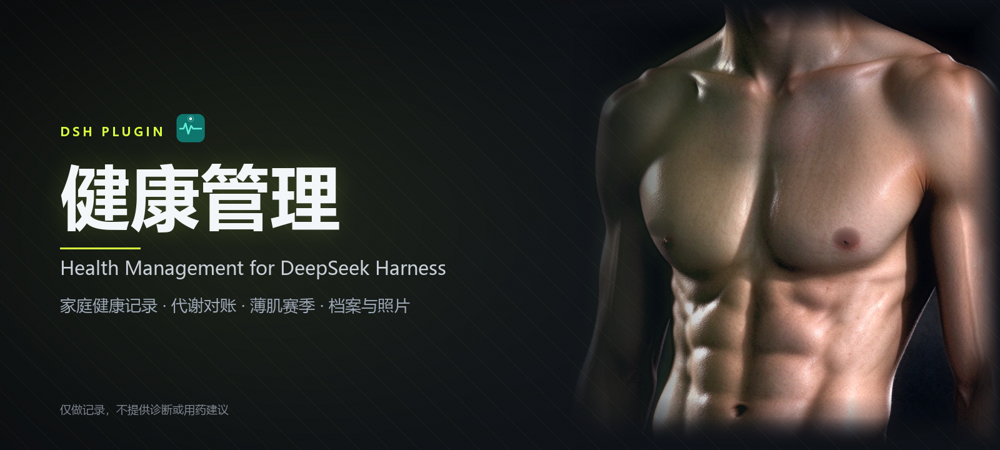
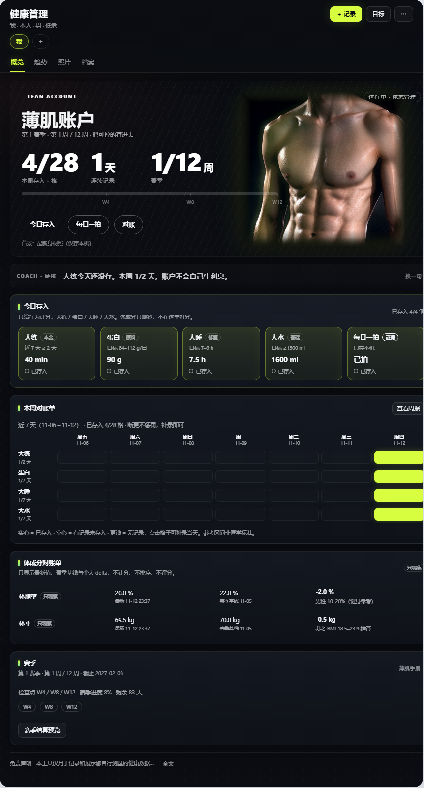

# Health Management for DeepSeek Harness

Local-only family health records and two management goals for DeepSeek Harness.

[](https://github.com/topics/dsh-plugin)
[](LICENSE)
[](package.json)
[](https://github.com/hebin-cl/dsh-health-management/releases)
[](https://www.npmjs.com/package/dsh-health-management)

<p align="center"></p>

Record blood pressure, glucose, lipids, uric acid, weight, waist, body fat, sleep, training and more for up to eight family members. Two management goals are built in: **metabolic management** (core indicators — waist, blood pressure, fasting glucose, triglycerides, HDL-C, BMI — shown against reference bands with target gaps) and **Lean Account** (training, meals, sleep and water accounts in a 12-week season). Records and descriptive statistics stay on this machine — no diagnosis, treatment or medication advice.

## Install in 30 seconds

```sh
# npm
dsh plugin --profile <your-profile> add dsh-health-management
# GitHub source
dsh plugin --profile <your-profile> add github:hebin-cl/dsh-health-management
# release tarball
dsh plugin --profile <your-profile> add https://github.com/hebin-cl/dsh-health-management/releases/latest/download/dsh-health-management.tgz
```

Requires DeepSeek Harness `>=0.2.2-rc.1 <0.3.0` and Node 22+; refresh the Web UI after install.

<p align="center"></p>

Lean Account overview: four behaviour accounts, the weekly ledger and the body-composition statement.

> Records and descriptive statistics only; no diagnosis, treatment, medication, training-plan, recipe or supplement advice; reference ranges are population references, not personal targets.

## What's new in 1.4.1

- **Member-aware key metrics in the quick card** — click Little Muscle King to see the current member's latest key values without opening the panel: weight / body fat / skeletal muscle / waist for a lean-muscle member, or a 7-day blood-pressure average plus fasting glucose / waist / triglycerides / HDL-C for a metabolic member. Values are reference only, never a diagnosis.
- **Goal-aware reminders** — an active lean-muscle goal alternates water and training prompts; an active metabolic goal prompts measure / meal / activity / sleep. The reminder uses record counts, goal codes and last water/training times, never a measurement value.
- **Lean account and menu cleanup** — the lean account is now 大练 / 大餐 / 大睡 / 大水; the top-level Diet tab is gone and clicking 大餐 opens the diet manager (today / 7-day summary, meals, add meal).
- **Default identity** — default name 小肌霸, default portrait from the supplied image, and the same portrait as the plugin icon. Both remain configurable.
- **Report AI interpretation** — upload a PNG / JPEG / WebP or `.txt` report to **Archive → Documents**, open **AI 解读**, and pick an image-capable model. The result explains the report's own values and reference ranges, labels the provider/model that produced it, and always shows a fixed "not a diagnosis; consult your doctor" disclaimer. A prescription is refused, a PDF asks for a screenshot/photo, and nothing is written to measurements or diagnosis tags. The report model is stored separately from the meal-estimate model.
- **Body-composition statement** — quick entry button, column headers, derived BMI on read and no fake `0` delta for a single season record.

## What's new in 1.4.0

- **Little Muscle King (小肌霸)** — a draggable floating health buddy on the Web panel, with its own DSH Settings page: name, built-in avatar or uploaded image, show/hide, size, saved position, reminder interval, quiet hours, bubble duration and optional desktop notifications. It only reads aggregate counts (records today, active goals) and never evaluates a value.
- **Meal photos** — record breakfast / lunch / dinner / snack with a photo; an image-capable model can propose kcal, protein and items, and nothing is saved until you confirm. The estimation route is automatic or pinned to one provider/model in the panel.
- **Metabolic management redesign** — behaviour accounts (测 / 吃 / 动 / 睡) counted as deposits, an observation-only indicator statement, a 12-week review cycle, weekly ledger and a copyable visit summary.
- Members gain height (BMI derives from weight + height) and an `unknown` risk level.

**Also in 1.3.2**

- Stored records with a metric this build does not ship are shown by code instead of failing the panel; legacy photo kinds stay in storage but are hidden from the photo wall.
- No data or storage change.

**Also in 1.3.1**

- Panel routes now ask the host's own request gate (Host/Origin + browser login) before answering; refusals get the host's 401/403 and no data.

**Also in 1.3.0**

- Four focused tabs: 概览 / 赛季 / 档案 / 发现.
- **Season** is its own section: hero, W4/W8/W12 checkpoints, weekly ledger, share card and squad entry.
- **Archive** is the single home for trends, photos and medical documents.
- **Discover** adds the Hangzhou Yuhang district pilot (10 venues), plus a local-only invite squad MVP.

Squad and venue features are MVP/pilot and labelled as such in the UI.

## Features

- **Family members** — up to 8 profiles, sex-aware reference ranges, optional risk level for LDL-C targets, optional height for BMI derivation.
- **Me first** — opens on **我** (self); other members appear only after the user adds them.
- **Metrics** — blood pressure, heart rate, fasting/postprandial glucose, HbA1c, lipids, uric acid, weight, BMI, waist, body fat, skeletal muscle, protein, kcal, water, sleep, strength-training minutes.
- **Management goals** — `metabolic` (core metabolic monitoring with a 12-week review cycle and a copyable visit summary) and `lean_muscle` (12-week lean account).
- **Lean Account** — 大练 / 大餐 / 大睡 / 大水 accounts; daily deposits; 7×4 weekly ledger; season checkpoints; season review; new season without deleting history.
- **Body-composition statement** — body fat, weight, muscle and waist are shown with reference bands and a season baseline delta; **never scored as pass/fail**.
- **Progress photos** — daily shot, photo wall, two-photo compare, season compare; files stay on this machine.
- **Meals** — breakfast / lunch / dinner / snack records with a photo and optional vision-model kcal/protein estimate; nothing is stored before confirmation.
- **Little Muscle King (小肌霸)** — draggable floating health buddy with configurable name, avatar, size, position, reminder interval, quiet hours and notifications in Settings.
- **Health archive** — medical records, prescriptions, lab reports, imaging and other documents; condition tags are separate from management goals.
- **Agent tools** — the model can read/write the same data: `health_record`, `health_query`, `health_stats`, `health_goal_*`, `health_goal_review`, `health_goal_start_season`, `health_condition_*`, `health_document_*`, `health_member_*`, `health_metrics`, `health_diagnose`.
- **Dark, focused UI** — the hero and the content below share one graphite/neon design; the metabolic view remains deliberately restrained.

## Install

Requires **DeepSeek Harness `>=0.2.2-rc.1 <0.3.0`** and Node.js 22+. The install commands are at the top of this page; after installing, refresh the Web UI (or restart the host if it asks).

### Find it in the DSH plugin market

The plugin is listed in the curated [awesome-dsh-plugin](https://github.com/awesome-dsh-plugin/awesome-dsh-plugin) catalog under **tools** — search `dsh-health-management` or `health management` in the **dshmarket / Discover** tab.

If your host cannot reach that catalog, add the included native format-1 index from **Plugins → Discover → Index sources**:

```text
https://raw.githubusercontent.com/hebin-cl/dsh-health-management/main/index.json
```

`index.json` is pinned to the v1.3.0 release commit; after a new tag, regenerate it with `node scripts/build-market-index.mjs --owner hebin-cl --source git`.

## Quick start

1. Open **Health Management** in the sidebar.
2. Add a member (or use the seeded “我”).
3. Set a goal: **代谢综合征管理** or **薄肌管理**.
4. For 薄肌: use **今日存入** for training/protein/sleep/water, **每日一拍** for a photo, and **本周对账单** to see the 7×4 grid. Open **赛季** for checkpoints W4/W8/W12, share card and squad.
5. Use **档案** for trends, photos and medical documents; **发现** for the Yuhang venue pilot and future services.
6. Use the top-bar **目标** to activate/pause a goal or set personal target values. Goal settings are intentionally not repeated as a card on the lean dashboard.

## Data and privacy

- Data is stored locally in `.dsh-health/` under the Harness working directory (or the configured `dataDir`): `members.json`, `records.json`, `conditions.json`, `documents.json`, `goals.json`, `photos.json`, and `photos/<memberId>/`.
- Photos are served by a same-origin route, validated as JPEG/PNG/WebP, and never uploaded to a cloud service. Deleting a photo deletes its file and metadata.
- No analytics, no telemetry, and no external network calls. The panel only talks to same-origin Host routes on this machine.
- The local squad MVP stores `community.json` next to the health data; it never leaves the machine. The invite-code copy uses a local Windows clipboard bridge.
- Venue data is a curated Yuhang pilot from public sources, served by the local Host; it is not a live booking API.
- Back up `.dsh-health/` to keep your data; deleting a member cascades their records, goals, photos and archive.

## Safety boundaries

The plugin and its agent prompt enforce the following:

- No diagnosis, disease inference, medication/stop-medication/dose advice, or treatment plans.
- Lean-muscle goals only record and display behaviour, reference ranges and trends. No personalised training plan, exercise prescription, recipe, supplement advice, or effect promise.
- Body composition is observation-only: no pass/fail score, no ranking, no body shaming, no comparison with other people.
- Management goals are intentions, not diagnoses. Condition tags are separate facts and are never inferred from values.
- Special populations (pregnancy, eating disorders, comorbid disease) should consult a clinician or registered dietitian.

## Development

No build step. The host half is ESM under `lib/` + `index.js`; the Web half is a browser module in `client.js` loaded through the DSH module loader.

```sh
npm test                 # node test/smoke.mjs
npm run check            # node --check for every source file + smoke
```

The smoke test uses a temporary directory; it never touches your real `.dsh-health/` data.

## Project layout

```
index.js              Host entry: tools, HTTP routes, system-prompt safety section
client.js             Web panel (dark dashboard, Lean Account, photos, archive)
lib/metrics.js        Metric registry and reference bands
lib/goals.js          Goal catalog + engine (accounts, season, ledger, statement)
lib/service.js        Storage and domain operations
lib/community.js      Local squad MVP store (invite-only, local-only)
lib/venues.js         Curated Hangzhou Yuhang venue pilot
lib/conditions.js     Condition tags and clinical target gaps
lib/store.js          Atomic JSON store
test/smoke.mjs        End-to-end service tests
assets/               Icon + hero art + screenshots
market/               Curated-registry submission template
scripts/              Checks and market-index generator
```

## Market listing

The submission PR is
[#15394](https://github.com/awesome-dsh-plugin/awesome-dsh-plugin/pull/15394); it
adds the single entry file kept here as
[`market/hebin-cl__dsh-health-management.yml`](market/hebin-cl__dsh-health-management.yml)
as `data/plugins/hebin-cl__dsh-health-management.yml` (PR body:
[`market/PR-BODY.md`](market/PR-BODY.md)).

1. The repository declares `dsh.bundle`, has the `dsh-plugin` topic, and is at
   least 1 day old.
2. The install sources are the GitHub source and the prebuilt
   `dsh-health-management.tgz` attached to a GitHub Release (the included
   workflow does this on a tag). npm is optional and not required for listing.
3. The `icon:` is a GitHub-hosted 180×180 PNG and the `tarball:` URL uses a
   version-free asset name on `latest/download/`, so it does not rot on the next
   release.
4. Screenshots are declared in this repository via
   [`screenshots.json`](screenshots.json) (four relative paths).
5. The repository already includes `index.json` for the host's native
   **Discover → Index sources**.

## License

MIT for the source code. The hero image and screenshots may include third-party or user-provided material; see [THIRD_PARTY_NOTICES.md](THIRD_PARTY_NOTICES.md) before redistributing or using them commercially.
