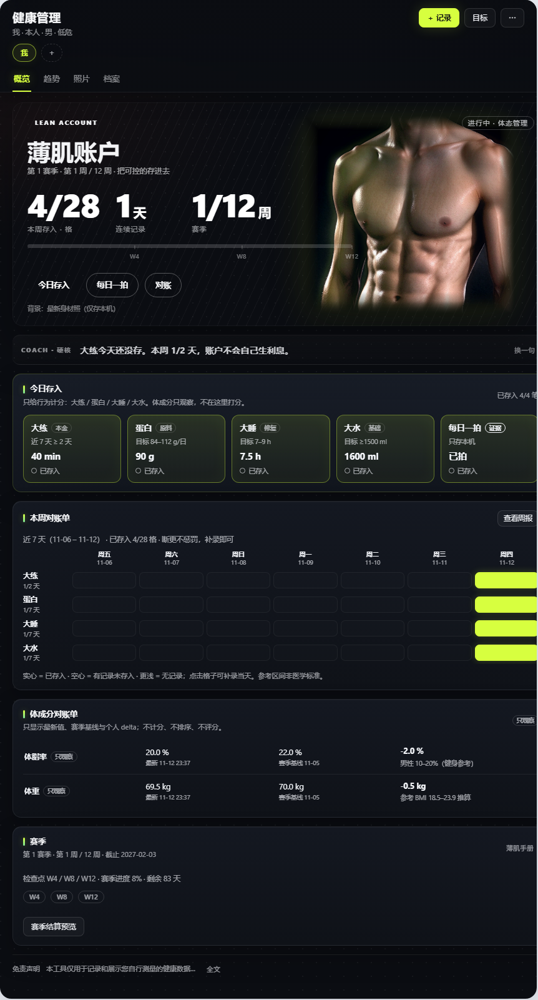

# Health Management for DeepSeek Harness

[](https://github.com/topics/dsh-plugin)
[](LICENSE)
[](package.json)

A family health workspace for **DeepSeek Harness**: record measurements, manage goals, and see the gap between what you want to manage and what the data says — without turning the panel into a medical chart.

The flagship view is **Lean Account / 薄肌账户**: four behaviour accounts (training, protein, sleep, water), a 12-week season, a weekly ledger, and a body-composition statement that is **observation-only**. The plugin also ships a metabolic monitoring view, progress photos, a health archive, and agent tools for the same data.

> Records and descriptive statistics only. Not a medical device. No diagnosis, treatment, medication, training-plan, recipe, or supplement advice. Reference ranges are population references, not personal targets. Always follow a clinician's advice.



## Features

- **Family members** — up to 8 profiles, sex-aware reference ranges, optional risk level for LDL-C targets.
- **Metrics** — blood pressure, heart rate, fasting/postprandial glucose, HbA1c, lipids, uric acid, weight, BMI, waist, body fat, skeletal muscle, protein, water, sleep, strength-training minutes.
- **Management goals** — `metabolic` (core metabolic monitoring) and `lean_muscle` (12-week lean account).
- **Lean Account** — 大练 / 蛋白 / 大睡 / 大水 accounts; daily deposits; 7×4 weekly ledger; season checkpoints; season review; new season without deleting history.
- **Body-composition statement** — body fat, weight, muscle and waist are shown with reference bands and a season baseline delta; **never scored as pass/fail**.
- **Progress photos** — daily shot, photo wall, two-photo compare, season compare; files stay on this machine.
- **Health archive** — medical records, prescriptions, lab reports, imaging and other documents; condition tags are separate from management goals.
- **Agent tools** — the model can read/write the same data: `health_record`, `health_query`, `health_stats`, `health_goal_*`, `health_goal_review`, `health_goal_start_season`, `health_condition_*`, `health_document_*`, `health_member_*`, `health_metrics`, `health_diagnose`.
- **Dark, focused UI** — the hero and the content below share one graphite/neon design; the metabolic view remains deliberately restrained.

## Install

Requires **DeepSeek Harness `>=0.2.2-rc.1 <0.3.0`** and Node.js 22+.

### From npm (recommended)

```sh
dsh plugin --profile <your-profile> add dsh-health-management
```

### From GitHub

```sh
dsh plugin --profile <your-profile> add github:hebin-cl/dsh-health-management
```

### From a release tarball

Download `dsh-health-management.tgz` from [Releases](https://github.com/hebin-cl/dsh-health-management/releases) and install the local file:

```sh
dsh plugin --profile <your-profile> add ./dsh-health-management.tgz
```

After install, refresh the Web UI (or restart the host if the profile asks for it).

### Discover it in the DSH plugin market

- The plugin is submitted to the curated [awesome-dsh-plugin](https://github.com/awesome-dsh-plugin/awesome-dsh-plugin) registry. Once merged, it becomes searchable in the **dshmarket** Discover tab and installable with one click.
- Until then, add a native format-1 index from **Plugins → Discover → Index sources**:

  ```
  https://raw.githubusercontent.com/hebin-cl/dsh-health-management/main/index.json
  ```

  (Generate `index.json` first with `node scripts/build-market-index.mjs --owner hebin-cl --source git` after the first commit, or publish to npm and use `--source npm`.)

## Quick start

1. Open **Health Management** in the sidebar.
2. Add a member (or use the seeded “我”).
3. Set a goal: **代谢综合征管理** or **薄肌管理**.
4. For 薄肌: use **今日存入** for training/protein/sleep/water, **每日一拍** for a photo, and **本周对账单** to see the 7×4 grid. The season card shows checkpoints W4/W8/W12.
5. Use the top-bar **目标** to activate/pause a goal or set personal target values. Goal settings are intentionally not repeated as a card on the lean dashboard.

## Data and privacy

- Data is stored locally in `.dsh-health/` under the Harness working directory (or the configured `dataDir`): `members.json`, `records.json`, `conditions.json`, `documents.json`, `goals.json`, `photos.json`, and `photos/<memberId>/`.
- Photos are served by a same-origin route, validated as JPEG/PNG/WebP, and never uploaded to a cloud service. Deleting a photo deletes its file and metadata.
- No analytics, no telemetry, no network calls from the plugin.
- Back up `.dsh-health/` to keep your data; deleting a member cascades their records, goals, photos and archive.

## Safety boundaries

The plugin and its agent prompt enforce the following:

- No diagnosis, disease inference, medication/stop-medication/dose advice, or treatment plans.
- Lean-muscle goals only record and display behaviour, reference ranges and trends. No personalised training plan, exercise prescription, recipe, supplement advice, or effect promise.
- Body composition is observation-only: no pass/fail score, no ranking, no body shaming, no comparison with other people.
- Management goals are intentions, not diagnoses. Condition tags are separate facts and are never inferred from values.
- Special populations (pregnancy, eating disorders, comorbid disease) should consult a clinician or registered dietitian.

## Development

No build step. The host half is ESM under `lib/` + `index.js`; the Web half is a browser module in `client.js` loaded through the DSH module loader.

```sh
npm test                 # node test/smoke.mjs
npm run check            # node --check for every source file + smoke
```

The smoke test uses a temporary directory; it never touches your real `.dsh-health/` data.

## Project layout

```
index.js              Host entry: tools, HTTP routes, system-prompt safety section
client.js             Web panel (dark dashboard, Lean Account, photos, archive)
lib/metrics.js        Metric registry and reference bands
lib/goals.js          Goal catalog + engine (accounts, season, ledger, statement)
lib/service.js        Storage and domain operations
lib/conditions.js     Condition tags and clinical target gaps
lib/store.js          Atomic JSON store
test/smoke.mjs        End-to-end service tests
assets/               Icon + hero art + screenshots
market/               Curated-registry submission template
scripts/              Checks and market-index generator
```

## Market listing

The submission entry is prepared at [`market/awesome-dsh-plugin-entry.yml`](market/awesome-dsh-plugin-entry.yml). To list the plugin:

1. Create/push the GitHub repository and add the `dsh-plugin` topic.
2. Publish to npm (optional but recommended), or attach a prebuilt `dsh-health-management.tgz` to a GitHub Release.
3. Fork `awesome-dsh-plugin/awesome-dsh-plugin`, add `data/plugins/<owner>__dsh-health-management.yml` from the template, and open a PR (the guide allows at most 3 entries per PR; a repository must be at least 1 day old).
4. Optional: generate `index.json` for the host’s native **Discover → Index sources**.

## License

MIT for the source code. The hero image and screenshots may include third-party or user-provided material; see [THIRD_PARTY_NOTICES.md](THIRD_PARTY_NOTICES.md) before redistributing or using them commercially.
