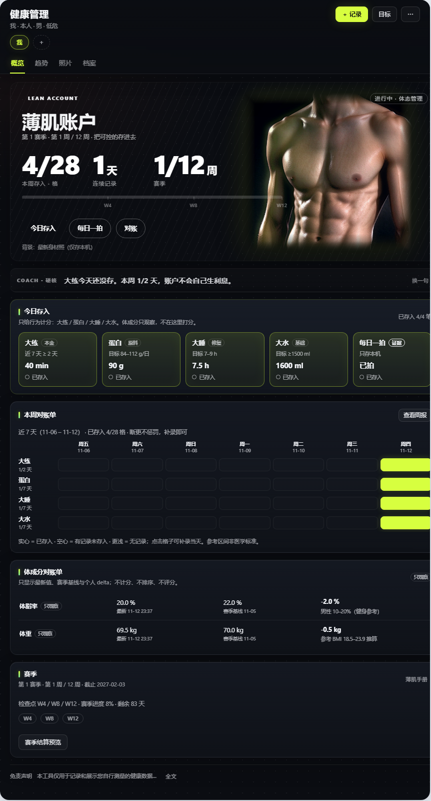

# 健康管理 · DeepSeek Harness 插件

[](https://github.com/topics/dsh-plugin)
[](LICENSE)

一个面向**家庭健康管理**的 DeepSeek Harness 插件：记录指标、设定管理目标、查看目标差距与记录覆盖度，而不是把面板做成一张冷冰冰的化验单。

主视图是 **薄肌账户**：大练 / 蛋白 / 大睡 / 大水四个行为账户、12 周赛季、每周对账，以及只观察不评分的体成分对账单。插件同时提供代谢管理视图、身材照片、健康档案，以及一套与面板共享同一份数据的 Agent 工具。

> 仅做记录与描述性统计，不是医疗器械。不提供诊断、治疗、用药、训练计划、食谱或补剂建议；参考区间为人群参考值，不等于个人目标值。请以医生意见为准。



## 功能

- **家庭成员**：最多 8 位；参考区间分性别，LDL-C 可按风险分层。
- **指标**：血压、心率、空腹/餐后血糖、糖化血红蛋白、血脂、尿酸、体重、BMI、腰围、体脂率、骨骼肌量、蛋白质、饮水、睡眠、力量训练时长。
- **管理目标**：`metabolic`（代谢综合征管理）与 `lean_muscle`（薄肌管理）。
- **薄肌账户**：练/吃/睡/水四账户；每日存入；7×4 周对账；W4/W8/W12 检查点；赛季结算；开启新赛季不删历史。
- **体成分对账单**：体脂/体重/骨骼肌/腰围显示参考区间与赛季基线 delta，**不计分、不排名、不评分**。
- **照片**：每日一拍、照片墙、两张对比、赛季对比；只存本机。
- **健康档案**：病历、处方、检验报告、影像等；疾病标签与管理目标语义分离。
- **Agent 工具**：`health_record`、`health_query`、`health_stats`、`health_goal_*`、`health_goal_review`、`health_goal_start_season`、`health_condition_*`、`health_document_*`、`health_member_*`、`health_metrics`、`health_diagnose`。
- **深色仪表盘**：hero 与下方内容统一为石墨/荧光绿视觉；代谢视图保持克制。

## 安装

需要 **DeepSeek Harness `>=0.2.2-rc.1 <0.3.0`** 与 Node.js 22+。

```sh
# npm（推荐）
dsh plugin --profile <profile> add dsh-health-management

# GitHub 源码
dsh plugin --profile <profile> add github:hebin-cl/dsh-health-management

# Release tarball
dsh plugin --profile <profile> add ./dsh-health-management.tgz
```

安装后刷新 Web UI；如果宿主提示需要重启，按提示重启。

## 快速开始

1. 在侧边栏打开「健康管理」。
2. 添加成员（或使用内置的「我」）。
3. 设定目标：代谢综合征管理 / 薄肌管理。
4. 薄肌：用「今日存入」记练/吃/睡/水，用「每日一拍」留证据，用「本周对账单」看 7×4 格；赛季卡显示 W4/W8/W12。
5. 顶栏「目标」用于激活/暂停目标与个人目标值；薄肌概览不重复展示目标卡。

## 数据与隐私

- 数据默认存放在工作目录下的 `.dsh-health/`（或配置的 `dataDir`）：`members.json`、`records.json`、`conditions.json`、`documents.json`、`goals.json`、`photos.json` 与 `photos/<memberId>/`。
- 照片由同源路由读取，校验 JPEG/PNG/WebP，不上传云端；删除照片会同时删除文件与元数据。
- 无统计、无遥测、无网络请求。
- 备份 `.dsh-health/` 即可保存数据；删除成员会级联删除其记录、目标、照片与档案。

## 安全边界

- 不诊断、不推断疾病、不调药/停药/改剂量、不给治疗方案。
- 薄肌目标只做行为、参考区间与趋势的记录和展示；不生成个性化训练计划、动作/组数、食谱或补剂建议，不承诺效果。
- 体成分只观察：不评分、不排名、不身体羞辱、不与他人比较。
- 管理目标表示意愿，不是诊断；疾病标签是独立事实，绝不从数值自动推断。
- 孕期、进食障碍、合并疾病等特殊人群请咨询医生或注册营养师。

## 开发

无构建步骤。Host 侧为 ESM（`index.js` + `lib/`），Web 侧为浏览器模块 `client.js`，通过 DSH module loader 加载。

```sh
npm test          # node test/smoke.mjs
npm run check     # 所有源文件 node --check + smoke
```

smoke 使用临时目录，不触碰真实 `.dsh-health/` 数据。

## 上架到 DSH 插件市场

- 投稿模板：[`market/awesome-dsh-plugin-entry.yml`](market/awesome-dsh-plugin-entry.yml)。
- 步骤：创建/推送 GitHub 仓库 → 加 `dsh-plugin` topic →（可选）发布 npm 或上传 Release tarball → fork `awesome-dsh-plugin/awesome-dsh-plugin`，把模板复制为 `data/plugins/<owner>__dsh-health-management.yml`，提 PR。
- 仓库需创建满 1 天；一个 PR 最多 3 条；描述必须与代码一致。
- 原生 Discover 索引：仓库已包含 `index.json`（指向初始发布 commit），在 **Plugins → Discover → Index sources** 添加 `https://raw.githubusercontent.com/hebin-cl/dsh-health-management/main/index.json` 即可；重写历史或发新 tag 后运行 `node scripts/build-market-index.mjs --owner hebin-cl --source git` 重新生成。

## 许可

源代码采用 MIT。主视觉图片与截图中可能包含第三方或用户提供的素材，再分发/商用前请阅读 [THIRD_PARTY_NOTICES.md](THIRD_PARTY_NOTICES.md)。
