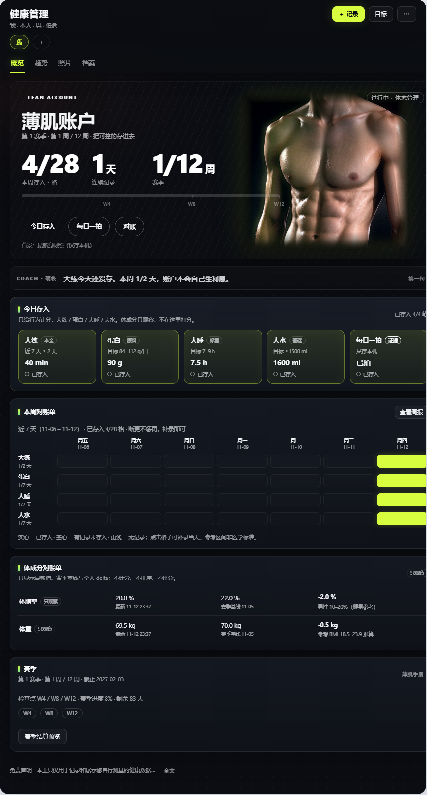

# 健康管理 · DeepSeek Harness 插件

本地家庭健康记录插件，内置代谢与薄肌两个管理目标。

[](https://github.com/topics/dsh-plugin)
[](LICENSE)
[](package.json)
[](https://github.com/hebin-cl/dsh-health-management/releases)
[](https://www.npmjs.com/package/dsh-health-management)

<p align="center"></p>

记录最多 8 位家庭成员的血压、血糖、血脂、尿酸、体重、腰围、体脂、睡眠、训练等指标。插件内置两个管理目标：**代谢管理**（腰围、血压、空腹血糖、甘油三酯、HDL-C、BMI 等核心指标，按参考区间与目标差距展示）和**薄肌账户**（大练 / 蛋白 / 大睡 / 大水四个行为账户，12 周一个赛季）。所有数据只保存在本机，只做记录与描述性统计，不提供诊断、治疗或用药建议。

## 30 秒安装

```sh
# npm
dsh plugin --profile <your-profile> add dsh-health-management
# GitHub 源码
dsh plugin --profile <your-profile> add github:hebin-cl/dsh-health-management
# Release tarball
dsh plugin --profile <your-profile> add https://github.com/hebin-cl/dsh-health-management/releases/latest/download/dsh-health-management.tgz
```

需要 DeepSeek Harness `>=0.2.2-rc.1 <0.3.0` 与 Node 22+；安装后刷新 Web UI。

<p align="center"></p>

薄肌账户概览：四个行为账户、本周对账单与体成分对账单。

> 仅做记录与描述性统计；不提供诊断、治疗、用药、训练计划、食谱或补剂建议；参考区间为人群参考值，不等于个人目标值。

## 1.3.2 更新

- 当某条记录带有当前版本不认识的指标代码时（例如由更新的预览版写入的数据），面板不再整页失败，而是按代码展示该值。
- 照片文档接受当前版本不渲染的 kind：未知的旧 kind 保留在存储中、从照片墙隐藏，不再阻塞启动。
- 数据与存储格式均无变化。

**1.3.1 回顾**

- 面板路由先经宿主自带的请求闸门（Host/Origin 校验 + 浏览器登录）再响应；被拒绝的请求返回宿主同款 401/403，且不返回数据。

**1.3.0 回顾**

- 主 Tab 收敛为 **概览 / 赛季 / 档案 / 发现**。
- **赛季**独立成版块：赛季 Hero、W4/W8/W12、周对账、分享卡、小队入口。
- **档案**统一承载趋势、照片与病历资料。
- **发现**接入杭州余杭区场馆试点（10 个场馆）；另有本地小队 MVP（邀请制，只在本机）。

小队与场馆为 MVP/试点能力，在界面中有标注。

## 功能

- **家庭成员**：最多 8 位；参考区间分性别，LDL-C 可按风险分层。
- **默认「我」**：打开即展示「我」；只有用户主动添加成员后，才出现其他成员。
- **指标**：血压、心率、空腹/餐后血糖、糖化血红蛋白、血脂、尿酸、体重、BMI、腰围、体脂率、骨骼肌量、蛋白质、饮水、睡眠、力量训练时长。
- **管理目标**：`metabolic`（代谢综合征管理）与 `lean_muscle`（薄肌管理）。
- **薄肌账户**：练/吃/睡/水四账户；每日存入；7×4 周对账；W4/W8/W12 检查点；赛季结算；开启新赛季不删历史。
- **体成分对账单**：体脂/体重/骨骼肌/腰围显示参考区间与赛季基线 delta，**不计分、不排名、不评分**。
- **照片**：每日一拍、照片墙、两张对比、赛季对比；只存本机。
- **健康档案**：病历、处方、检验报告、影像等；疾病标签与管理目标语义分离。
- **Agent 工具**：`health_record`、`health_query`、`health_stats`、`health_goal_*`、`health_goal_review`、`health_goal_start_season`、`health_condition_*`、`health_document_*`、`health_member_*`、`health_metrics`、`health_diagnose`。
- **深色仪表盘**：hero 与下方内容统一为石墨/荧光绿视觉；代谢视图保持克制。

## 安装

需要 **DeepSeek Harness `>=0.2.2-rc.1 <0.3.0`** 与 Node.js 22+。安装命令在页首；安装后刷新 Web UI，若宿主提示需要重启，按提示重启。

### 在 DSH 插件市场里找到它

插件已收录在精选目录 [awesome-dsh-plugin](https://github.com/awesome-dsh-plugin/awesome-dsh-plugin) 的 **tools** 分类下——在 **dshmarket / 发现（Discover）** 里搜索 `dsh-health-management` 或 `health management` 即可。

如果宿主访问不到该目录，也可以把本仓库自带的 format-1 索引加到 **Plugins → 发现 → 索引源（Index sources）**：

```text
https://raw.githubusercontent.com/hebin-cl/dsh-health-management/main/index.json
```

`index.json` 目前钉在 v1.3.0 的发布提交上；打新 tag 后用 `node scripts/build-market-index.mjs --owner hebin-cl --source git` 重新生成。

## 快速开始

1. 在侧边栏打开「健康管理」。
2. 添加成员（或使用内置的「我」）。
3. 设定目标：代谢综合征管理 / 薄肌管理。
4. 薄肌：用「今日存入」记练/吃/睡/水，用「每日一拍」留证据，用「本周对账单」看 7×4 格；到「赛季」看 W4/W8/W12、分享卡和小队。
5. 用「档案」看趋势/照片/病历资料；用「发现」看余杭区场馆与后续服务。
6. 顶栏「目标」用于激活/暂停目标与个人目标值；薄肌概览不重复展示目标卡。

## 数据与隐私

- 数据默认存放在工作目录下的 `.dsh-health/`（或配置的 `dataDir`）：`members.json`、`records.json`、`conditions.json`、`documents.json`、`goals.json`、`photos.json` 与 `photos/<memberId>/`。
- 照片由同源路由读取，校验 JPEG/PNG/WebP，不上传云端；删除照片会同时删除文件与元数据。
- 无统计、无遥测、无外部网络请求；面板只访问本机同源 Host 接口。
- 本地小队 MVP 写入同目录 `community.json`，不离开本机；邀请码复制使用本机 Windows 剪贴板桥接。
- 场馆为杭州余杭区试点，来自公开来源（来源日期见卡片），不是实时订场 API。
- 备份 `.dsh-health/` 即可保存数据；删除成员会级联删除其记录、目标、照片与档案。

## 安全边界

- 不诊断、不推断疾病、不调药/停药/改剂量、不给治疗方案。
- 薄肌目标只做行为、参考区间与趋势的记录和展示；不生成个性化训练计划、动作/组数、食谱或补剂建议，不承诺效果。
- 体成分只观察：不评分、不排名、不身体羞辱、不与他人比较。
- 管理目标表示意愿，不是诊断；疾病标签是独立事实，绝不从数值自动推断。
- 孕期、进食障碍、合并疾病等特殊人群请咨询医生或注册营养师。

## 开发

无构建步骤。Host 侧为 ESM（`index.js` + `lib/`），Web 侧为浏览器模块 `client.js`，通过 DSH module loader 加载。

```sh
npm test          # node test/smoke.mjs
npm run check     # 所有源文件 node --check + smoke
```

smoke 使用临时目录，不触碰真实 `.dsh-health/` 数据。

## 上架到 DSH 插件市场

- 已向精选目录 [`awesome-dsh-plugin`](https://github.com/awesome-dsh-plugin/awesome-dsh-plugin) 提交 PR
  [#15394](https://github.com/awesome-dsh-plugin/awesome-dsh-plugin/pull/15394)，
  条目文件为 [`market/hebin-cl__dsh-health-management.yml`](market/hebin-cl__dsh-health-management.yml)，
  PR 描述见 [`market/PR-BODY.md`](market/PR-BODY.md)；合并后可在 **dshmarket / Discover** 搜索并一键安装。
- 收录要求：仓库声明 `dsh.bundle`、带 `dsh-plugin` topic、创建满 1 天；一个 PR 最多 3 条；描述必须与代码一致；
  `icon:` 只能是 GitHub 托管位图，`tarball:` 用不带版本号的文件名；截图由本仓库的
  [`screenshots.json`](screenshots.json) 声明。npm 可选，本次未发布。
- 原生 Discover 索引：仓库已包含 `index.json`（指向 `v1.3.0` 标签提交），在 **Plugins → Discover → Index sources**
  添加 `https://raw.githubusercontent.com/hebin-cl/dsh-health-management/main/index.json` 即可；重写历史或发新 tag 后运行
  `node scripts/build-market-index.mjs --owner hebin-cl --source git` 重新生成。

## 许可

源代码采用 MIT。主视觉图片与截图中可能包含第三方或用户提供的素材，再分发/商用前请阅读 [THIRD_PARTY_NOTICES.md](THIRD_PARTY_NOTICES.md)。
